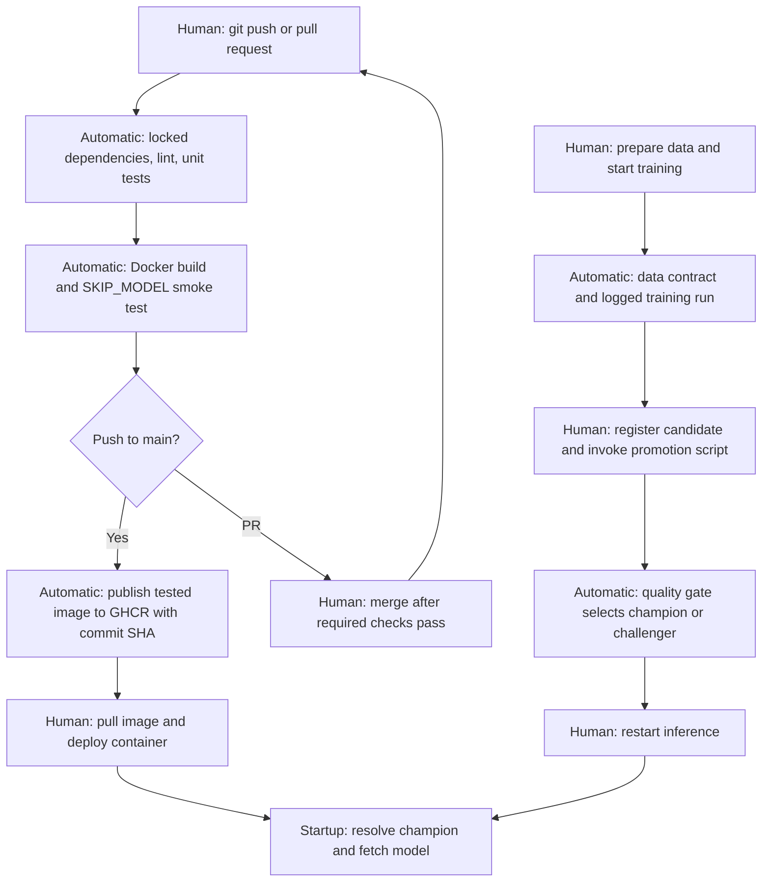

# Lab 5 answers

## 1. Why unit tests use a fake model

A real model introduces unrelated failures: MLflow may be offline, credentials
may expire, artifacts may be missing, or the alias may change. Unit tests should
check code deterministically without a server, GPU, or downloaded dataset.

## 2. What the fake-model test proves

It checks image decoding, preprocessing shape/type, class mapping, softmax,
and the response JSON. It does not measure classification accuracy or prove
that the real model can be downloaded. Our fake returns log probabilities so
the API's softmax produces 90% confidence for Bread.

## 3. Detecting duplicates

The content-hash check detected the deliberate training/evaluation duplicate.
Unlike a corrupt image, leakage can silently inflate evaluation scores and
make an overfitted model look ready to deploy.

The original mini dataset also contained 43 cross-split duplicate copies.
`prepare_lab5_data.py` creates a separate deduplicated copy under
`data_local/food11_lab5`, preserving evaluation images and the original data.
The clean copy passed all five checks; adding one duplicate made only the
leakage check fail, and the probe was then removed.

## 4. Where the data contract runs

Run it immediately after data preparation/DVC restoration, and before training
or promotion in an environment that can access the dataset. Training now
refuses to start when validation fails. Cloud CI tests the validator on small
synthetic datasets; it does not claim to validate unavailable DVC data.

## 5. Job dependencies

If `test` fails, `smoke` is skipped because it declares `needs: test`.
Without that dependency, both jobs could run independently and waste a build
on code whose tests already fail. Publishing depends on successful smoke tests.

## 6. Run time and caching

The first successful run took **6m 47s**; the empty-commit repeat took **2m 18s**.
The Docker build step fell from **4m 49s to 40s** by reusing cached layers.
`uv sync` fell from 7s to 5s; test time itself did not improve consistently.
These totals include job scheduling and cleanup.

Evidence: [first successful run](https://github.com/kfouryalexis121-alt/mlops-lab-1/actions/runs/44090737302)
and [empty-commit repeat](https://github.com/kfouryalexis121-alt/mlops-lab-1/actions/runs/44091977842).

## 7. Commit SHA versus latest

A SHA tag identifies the source commit. If machine A pulls `latest` before a
new push and machine B pulls afterward, they can run different code under the
same tag. Use an image digest when byte-for-byte identity must be enforced.
This workflow publishes the exact image tested by `smoke`, rather than
rebuilding it in the publishing job.

## 8. Token permissions

Tests and builds only need repository read access. Only the publishing job
gets `packages: write`. A broadly privileged compromised step could modify
repository contents, releases, or settings instead of just publishing images.

## 9. Protected pull requests

`main` now requires a pull request and passing `test` and `smoke` checks,
including for administrators. [PR #1](https://github.com/kfouryalexis121-alt/mlops-lab-1/pull/1)
initially asserted that a Bread filename meant Egg. GitHub reported the test
failure, skipped smoke, and marked the PR `blocked`. The intentional failure
was then removed before the final checks. This enforces a shared merge rule
instead of relying on every developer remembering local tests.

## 10. Candidate promotion

The gate compares candidate accuracy with `p + 2 * sqrt(p * (1-p) / n)`, where
`p` is champion accuracy and `n` is the evaluation size. Passing candidates
become `champion`; others become `challenger`. Both accuracies, the threshold,
sample size, previous champion, and decision are stored as version tags.

The champion scored **76.2774%** on **1,096** evaluation images. Its standard
error was **1.2849 percentage points**, giving a two-SE margin of **2.5698
points** and a promotion threshold of **78.8472%**.

| Candidate | Learning rate | Epochs | Test accuracy | Decision |
|---|---:|---:|---:|---|
| Version 2 | 0.000001 | 5 | 14.3248% | Challenger |
| Version 3 | 0.0001 | 5 | 75.4562% | Challenger |

Run IDs: version 2 is `bd2c0a7a96334191b939008892e51769`; version 3 is
`1f46b02eba454749b9cbb000892d8240`. Both used batch size 32 and seed 42.
`champion` remains version 1; `challenger` now points to version 3. The decision
tags remain on both candidates.

The old champion was trained before duplicate removal, so re-evaluating it
does not undo its historical data leakage. This comparison demonstrates the
lab gate; a trustworthy production baseline must also be retrained on clean data.

## 11. Automating model promotion

Run the promotion command after training on a local/self-hosted runner with
MLflow access, or host MLflow on a reachable service such as DagsHub and supply
credentials to the workflow. Promotion does not automatically restart the API;
that remains a separate deployment action.

## 12. Pipeline

The image's code version is chosen by its commit SHA/digest. The registry's
`champion` alias selects the model version when inference starts. CI never
trains the production model and does not deploy to the laptop automatically.
